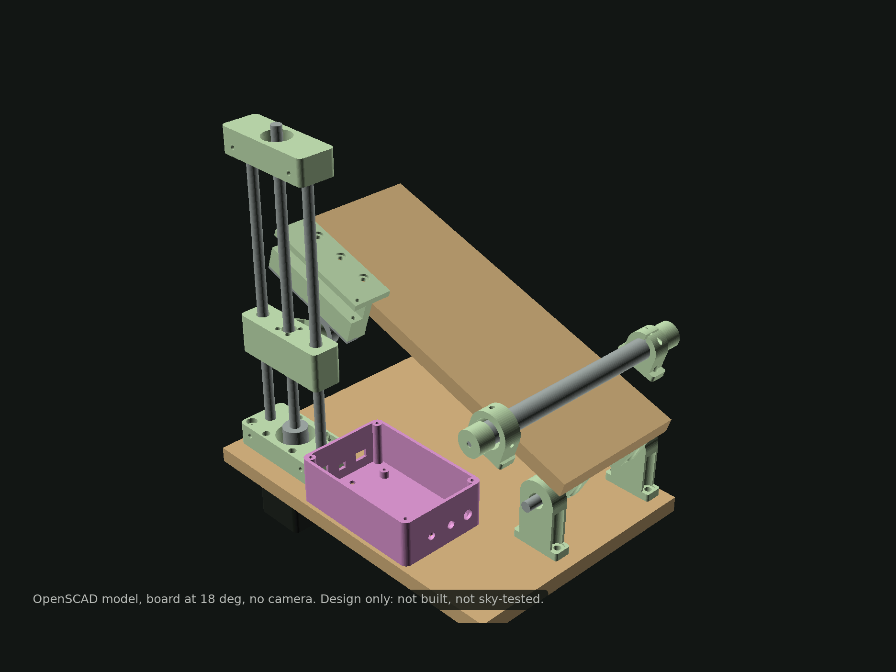
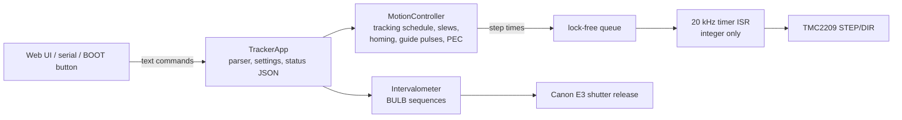

# Star tracker

**A 3D-printed barn-door tracker whose ESP32 times every microstep from the mechanism's geometry, so the barn door's tangent error is removed in firmware instead of in the mechanics.**

[](https://github.com/Kronbii/star-tracker/actions/workflows/ci.yml)



*The OpenSCAD model. I have designed, compiled and tested this in software, and I have not built it yet; the build is next.*

## What it is

I designed this tracker for one goal: a sharp photograph of the Orion Nebula (M42) from Lebanon with a Canon DSLR. The repository holds the whole design:

- **Parametric CAD** in OpenSCAD: 15 printed parts, STLs and drill templates.
- **ESP32 firmware** that drives the stepper, runs an intervalometer and serves a night-vision web UI.
- **A Python error model** that predicts the longest sharp exposure for each lens.
- **A planner** that scans the season for moonless nights when M42 is high over Beirut.
- **An autoguiding prototype**, tested so far only on synthetic star fields.

### Why it matters

The sky turns 15 arcseconds per second. At 200 mm on an APS-C camera, a fixed tripod smears stars in **0.38 s**. A barn door is the cheapest way to follow the sky: two boards on a hinge pointed at the pole, opened at the sidereal rate. It has one well-known flaw. A straight screw pushing a board that swings in an arc does not open it at a constant angular rate. Driven at constant speed, this design would drift off the sky by about 30 arcminutes in the first hour and more than four degrees over its full travel.

The usual fixes are mechanical: a curved rod, or a second arm. I took the other route. The error is pure geometry, so the firmware can remove it exactly.

## Highlights

These are design values, simulations and predictions. None of them are sky measurements yet.

| | |
|---|---|
| Tracking residual | **±0.32″** (half a microstep) over a 2 h simulated sidereal run of the firmware scheduler |
| Reduction | **629:1** from a 2 mm-lead screw at 200 mm, **0.64″ per microstep** |
| Sharp exposure at 200 mm, APS-C | **21 s** predicted (11 s worst case), against 0.38 s untracked |
| With periodic-error correction | about 77 s predicted |
| Tracking per rewind | 2.35 h |
| Tests | 110: 60 C++ host tests on the firmware core (ASan + UBSan), 50 Python |
| Parts | about 140 USD (estimate), excluding tripod and camera |

## How it works

### 1. Choose the drive by division

Every error that starts at the motor, such as uneven microsteps or an eccentric coupler, is divided by the reduction ratio before it reaches the sky. I compared printed worm gears, belt drums, geared steppers and lead screws on that basis. A Tr8x2 lead screw pushing a 200 mm arm gives 629:1 from parts sold for 3D-printer Z axes. Printed worms and belt drums reach a fraction of that.

### 2. Schedule steps, not speed

The firmware never runs the motor at a speed. A roller on the screw carriage pushes a strike strip on the top board, and that contact has a closed-form relation between screw height and board angle, plus its inverse:

```
h(θ) = R tan θ − c sec θ
θ(h) = atan2(h, R) + asin(c / √(R² + h²))
```

For each microstep, the firmware computes the instant the ideal sidereal angle crosses that step's true angle and fires the step then. Every step is placed against the ideal angle rather than added to the previous one, so errors cannot accumulate.


*Constant speed against the firmware's schedule. Host simulation of the same C++ code the ESP32 runs.*

The ESP32 cannot use its floating-point unit inside interrupts, so the work is split in two:



A 1 kHz task does the trigonometry and fills the queue; the 20 kHz interrupt only compares integer timestamps and pulses the driver.

### 3. Predict before building

The Python model converts each error source into on-sky trail: polar misalignment, drive-rate error, the screw's periodic error, microstep error, quantisation and refraction. From that it finds the longest exposure that keeps stars within 1.5 px.


The model changed the plan. With an assumed periodic error of ±4 µm, the screw's wobble outweighs polar-alignment error up to about one degree of misalignment. A better polar scope would buy little; the periodic-error correction table, which the firmware already supports, is the lever.

### 4. Plan the night

The planner scans every night from October to March with skyfield and JPL DE421 for full darkness, M42 above 30° and the Moon down or nearly new, then writes a first-session plan with times, exposure settings and calibration frames: [`docs/session-plan.md`](docs/session-plan.md).

## Quick start

Python tools (error budget, planner, figures):

```bash
uv venv && uv pip install -e ".[dev]"
.venv/bin/startracker fetch-ephemeris          # optional: JPL DE421 for the planner
.venv/bin/startracker budget --focal 200       # predicted trail budget
.venv/bin/startracker exposure --focal 200     # exposure rules and sub plan
.venv/bin/startracker plan --not-before 2026-11-01 --out docs/session-plan.md
.venv/bin/startracker polaris                  # Polaris clock position now
.venv/bin/startracker figures                  # regenerate figures/
.venv/bin/pytest
```

Firmware (ESP32 Arduino core 3.3.11):

```bash
arduino-cli core install esp32:esp32@3.3.11 \
  --additional-urls https://espressif.github.io/arduino-esp32/package_esp32_index.json
arduino-cli compile --fqbn esp32:esp32:esp32 firmware/star_tracker
arduino-cli upload  --fqbn esp32:esp32:esp32 -p /dev/ttyUSB0 firmware/star_tracker
```

Host tests of the firmware core, and the CAD export:

```bash
cmake -S firmware/test -B firmware/test/build && cmake --build firmware/test/build -j
firmware/test/build/core_tests

cad/build.sh    # STLs, drill templates, renders
```

## Hardware and build plan

| Part | What I chose |
|---|---|
| Controller | ESP32 dev board |
| Driver and motor | TMC2209 at 1/16 microstepping, NEMA17 under the bottom board |
| Drive | Tr8x2 lead screw (2 mm lead, not the common Tr8x8), two 8 mm rods, LM8UU carriage |
| Hinge (polar axis) | two 608 bearings on an 8 mm shaft |
| Contact | a 608 bearing as a roller against a 10 × 2 mm steel strike strip |
| Home | micro switch, wired normally closed so a broken wire stops the move |
| Camera | Canon E3 release through two PC817 optocouplers |
| Polar alignment | printed sight tube with a reticle and a Polaris clock in the web UI |
| Power | 3S Li-ion pack, buck converter to 5 V |

The full list with part numbers and price estimates is in [`hardware/bom.csv`](hardware/bom.csv), and the wiring in [`hardware/wiring.md`](hardware/wiring.md). The plan from here:

1. Print the parts and assemble them, following [`docs/build-guide.md`](docs/build-guide.md).
2. Run the bench tests, then measure the real screw's periodic error and load the correction table.
3. First light on M42 in a moonless November window, following [`docs/first-night.md`](docs/first-night.md) and [`docs/session-plan.md`](docs/session-plan.md), and compare star shapes with the predictions.

## Repository layout

```
firmware/star_tracker/            ESP32 sketch: step ISR, web UI, settings
firmware/star_tracker/src/core/   hardware-independent C++17 core, shared with the host tests
firmware/test/                    host unit tests (CMake) and the tracking simulation
src/startracker/                  Python: error model, planners, figures, autoguiding, CLI
tests/                            pytest suite
cad/                              OpenSCAD model, STLs, drill templates, build script
hardware/                         bill of materials, wiring
docs/                             build guide, first night, session plan, autoguiding
figures/                          generated figures and data
```

## Limits and what's next

- **Not built and not tested under the sky.** Every performance figure is a model prediction.
- **The screw's periodic error is assumed** at ±4 µm. It is the biggest uncertainty and dominates the predicted budget; measuring it is the first job after the build.
- **Single axis.** Declination drift can be measured, not corrected.
- **Polar alignment with the sight tube is coarse**, predicted at 0.15–0.4°.
- **Autoguiding** is the next step after first light: a small guide camera, star detection and guide pulses over the tracker's HTTP interface. The prototype has only seen synthetic star fields so far ([`docs/autoguiding.md`](docs/autoguiding.md)).

## Links

- Project page: [ramikronbi.com/projects/esp32-barn-door-star-tracker](https://ramikronbi.com/projects/esp32-barn-door-star-tracker)
- Write-up: [A barn-door tracker that does the maths](https://ramikronbi.com/writing/a-barn-door-tracker-that-does-the-maths)
- Licences: code under [MIT](LICENSE), hardware design under [CERN-OHL-P-2.0](LICENSE-HARDWARE). Citation metadata in [`CITATION.cff`](CITATION.cff).

Built by Rami Kronbi — [ramikronbi.com](https://ramikronbi.com)
