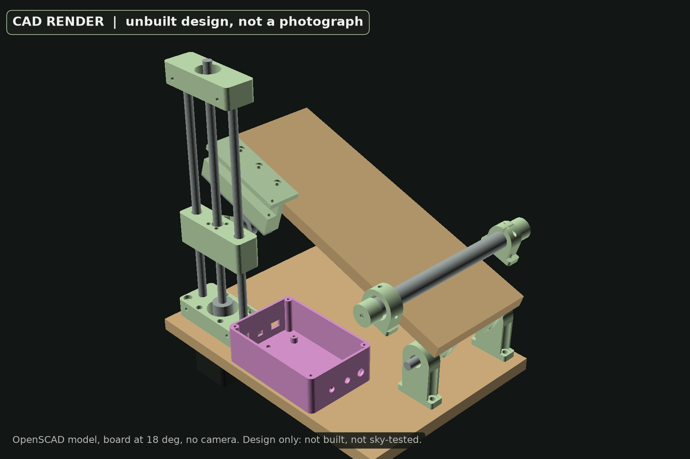
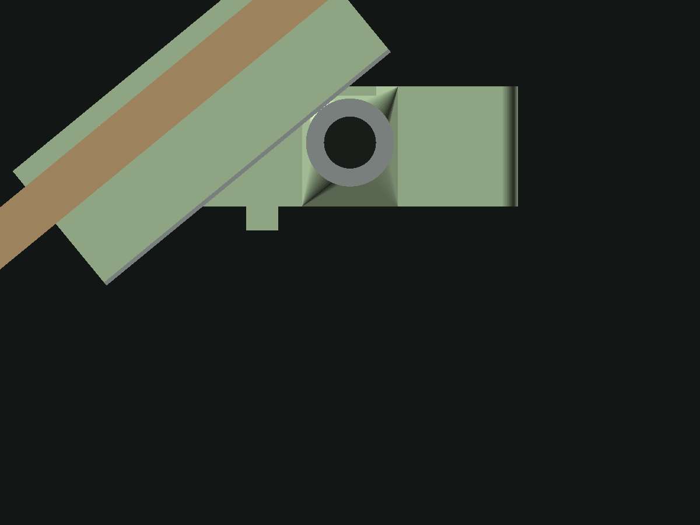
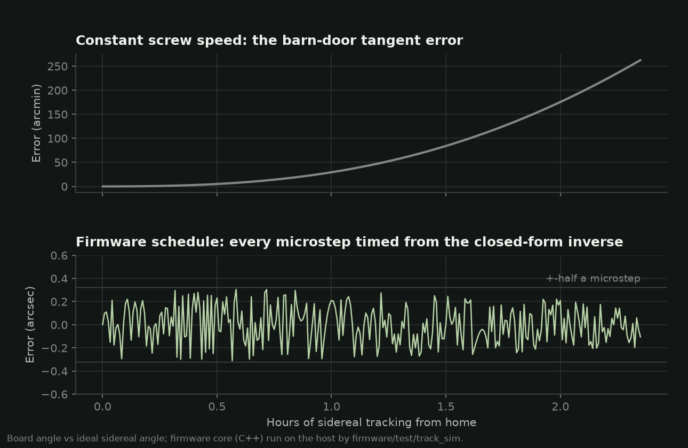
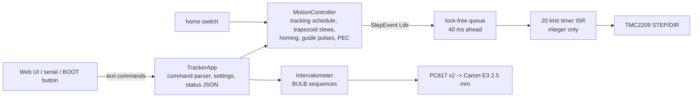
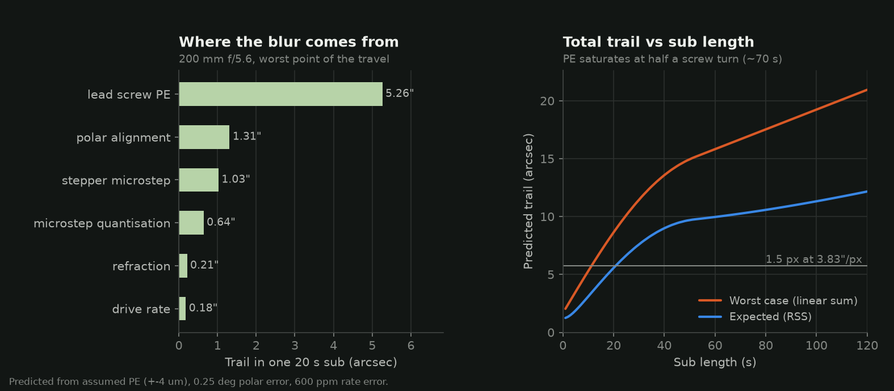
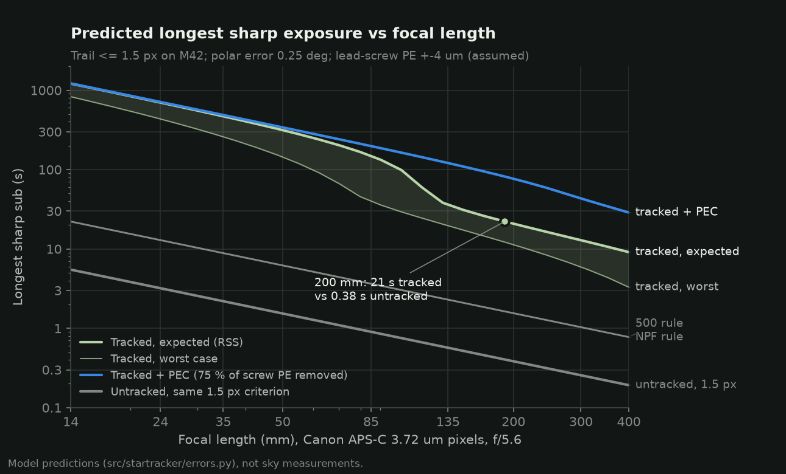
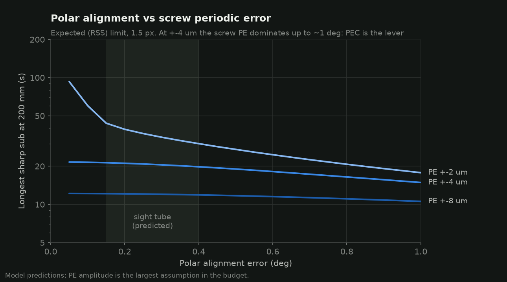

# Star tracker: a barn door that does the maths

An ESP32-driven, 3D-printed equatorial tracker for astrophotography with a Canon DSLR. The goal
it was designed against: **one sharp photograph of the Orion Nebula (M42) from Lebanon.**


*CAD render (OpenSCAD) of the design. It has not been built yet; this is not a photograph.*

**Status (October 2026): designed, modelled, compiled and unit-tested; not yet built or
tested under the sky.** Every performance number below comes from the models in this repository
and is labelled *predicted*.

| | |
|---|---|
| Design | tangent-arm barn door, NEMA17 + Tr8x2 lead screw in a printer-style Z tower, firmware tangent correction |
| Effective reduction | 629:1 at home; **0.64 arcsec per microstep** |
| Tracking per rewind | **2.35 h** (4.0 -> 39.4 deg of board travel) |
| Predicted sharp sub, 200 mm f/5.6, APS-C | **21 s** expected / 11 s worst case (untracked: 0.38 s) |
| Predicted with PEC (75 % of screw PE removed) | 77 s expected |
| Firmware | ESP32 Arduino; 60 host unit tests on the hardware-independent core; compiles with arduino-cli |
| Tools | Python package: error budget, exposure planner, M42 planner for Beirut, autoguiding prototype; 50 pytest tests |
| Cost | about 140 USD in parts (estimate), excluding tripod and camera |

## 1. Why track at all

The sky turns 15.04 arcsec per second. With a 24 MP Canon APS-C sensor (3.72 um pixels) behind
a 200 mm lens one pixel spans 3.83 arcsec, so a fixed camera smears stars by 1.5 px in
**0.38 s**. The popular rules of thumb allow more blur (500 rule: 1.6 s, NPF: 1.5 s) but either
way M42's faint outer nebula needs minutes of exposure that a fixed tripod cannot give. A
tracker turns the camera about an axis parallel to Earth's at the same rate.

## 2. Design choice

| Option | Reduction from commodity parts | Weak point | Verdict |
|---|---|---|---|
| Printed worm gear + stepper | 60-150:1 | printed worm PE, backlash | rejected |
| GT2 belt drum, 1-2 stages | 50-120:1 | motor-side errors only divided by ~100 | rejected |
| 28BYJ-48 geared stepper | 64:1 internal | gearbox backlash and PE | rejected |
| **Barn door + lead screw** | **629:1 (Tr8x2 at R = 200 mm)** | tangent error, screw PE | **chosen**: the tangent error is pure geometry, removed in firmware |

The deciding argument is division: every error that originates at the motor (microstep
non-linearity, coupler eccentricity) is divided by the reduction ratio before it reaches the
sky. A 2 mm-lead screw pushing a 200 mm arm gives 629:1 from a 3D-printer Z-axis kit; one
microstep is 0.64 arcsec. What a lead screw adds - the barn door's notorious tangent error - is
deterministic, so the firmware removes it exactly instead of the mechanics approximating it.

**Mechanics** ([`cad/star_tracker.scad`](cad/star_tracker.scad)): two plywood boards on a hinge
of two 608 bearings and an 8 mm shaft (the polar axis). A printer-style tower on the bottom board
(NEMA17 under the board, jaw coupler, Tr8x2 screw, two 8 mm rods, LM8UU carriage with a floating
brass nut) lifts a 608 bearing used as a roller; the roller pushes a 10 x 2 mm steel strip on the
top board whose face lies in the plane of the hinge axis. A home switch references the
geometry. A 200 mm sight tube on the top board, parallel to the hinge, carries a reticle whose
aperture radius is Polaris' distance from the pole. All 15 printed parts fit a 180 mm bed.


*CAD render (OpenSCAD) of the unbuilt design: roller and strike strip at the end of travel, 39 deg.*

## 3. The maths

**Rates** (mount rotation about the polar axis): sidereal 2 pi / 86164.0905 s = 15.0411"/s;
solar 15.0000"/s; lunar (mean) 15.0411 - 360 deg / 27.3217 d = 14.4921"/s.

**Geometry.** Hinge axis at the origin, screw at distance R = 200 mm, roller (radius r = 11 mm)
centre at height h, strike face through the hinge axis at board angle theta. Tangency gives

```
R sin(theta) - h cos(theta) = c          (c = r - strike-face offset = 11 mm)
h(theta) = R tan(theta) - c sec(theta)
theta(h) = atan2(h, R) + asin(c / sqrt(R^2 + h^2))
d(theta)/dh = cos^2(theta) / (R - c sin(theta))
```

A constant screw speed would therefore drift off sidereal by 30 arcmin in the first hour and
4.4 deg over the full travel (figure below, top).

**Scheduling, not rate control.** The firmware never runs the motor at "a speed". For tracking
started at (t0, theta0) it schedules microstep k at the instant the ideal angle
theta0 + w (t - t0) crosses the true angle of position p + 1/2, computed with the closed-form
inverse above (plus the PEC table, if loaded). Errors cannot accumulate; the board angle stays
within +-half a microstep (0.32") of sidereal for the whole run. That claim is checked by the
host tests on the same C++ code the ESP32 runs, and by `track_sim`, which produced the lower
panel:



**Numbers.** Tr8x2 lead, 200 full steps x 16 microsteps = 1600 microsteps/mm. At home the nut
moves 14.6 um/s (23.4 microsteps/s); at the end of travel 23.6 um/s (37.7 microsteps/s). One
screw turn takes 137 s at home and 85 s at the end, which sets the PE period. Torque: about
12 mN.m at the screw for a 1.5 kg payload (predicted), versus ~200 mN.m from a NEMA17 at 0.5 A.

## 4. Firmware

ESP32 (Arduino framework). Everything that is not hardware lives in
[`firmware/star_tracker/src/core/`](firmware/star_tracker/src/core/): plain C++17, no Arduino
headers, compiled into both the firmware and the host tests.



- **Tracking** at sidereal, lunar, solar or a custom rate; rate trim in ppm; pulse guiding
  (`guide <ms> <0..2x>`); periodic-error correction table (64 entries per screw turn).
- **Slews** (rewind, goto angle, jog) with trapezoidal acceleration limits (8000 microsteps/s,
  16000 /s^2), deceleration on stop, stop-then-reverse on retarget.
- **Homing**: fast approach, back-off, slow approach that stops on the exact step, park 0.5 mm
  above the switch. Switch wired normally-closed (fail-safe); unexpected hits stop the move.
- **Intervalometer** for Canon E3 bodies through two optocouplers (focus, shutter; wiring in
  [`hardware/wiring.md`](hardware/wiring.md)); timing taken from the schedule, not the loop, so a
  late loop never lengthens an exposure; a sequence aborts if tracking runs out of travel.
- **Web UI** on the tracker's own Wi-Fi access point, red-on-black for night vision: tracking,
  homing, jog, BULB sequences, battery, and the **Polaris clock** for the sight tube (hour angle
  from the phone's clock and the site longitude, IAU 1976 precession).
- **ISR**: the ESP32 cannot use the FPU in interrupts, so the 20 kHz ISR only compares integer
  timestamps and pulses STEP; all floating-point planning happens in a 1 kHz task.

## 5. Error budget

Contributions to the trail in one exposure, all converted to on-sky arcseconds
([`src/startracker/errors.py`](src/startracker/errors.py)):

| Source | Model | Assumed input |
|---|---|---|
| Polar alignment | exact rotation Ra(phi) Rz(-phi); worst case chi = 2 acos(1 - sin^2(phi/2)(1 - cos eps)) ~ eps w T, checked against a full rotation-matrix simulation | eps = 0.25 deg (sight tube) |
| Drive rate | w T x ppm | 600 ppm (RSS of R +-0.1 mm: 380, c: 160, home: 160, lead: 200, clock: 20) |
| Lead-screw PE | 1/rev + 2/rev waveform, worst window | **+-4 um axial (assumed)**, +-1 um 2nd harmonic |
| Stepper microstep | 1 full-step period | +-5 % of a full step |
| Quantisation | one microstep | 0.64" |
| Refraction | Saemundsson, change during the sub | M42 within +-3 h of transit |



## 6. Predicted performance

Longest sub whose predicted trail stays within 1.5 px, M42, Canon APS-C 3.72 um, f/5.6:

| Focal length | Scale | Untracked | Tracked, expected (RSS) | Tracked, worst (sum) | + PEC, expected |
|---|---|---|---|---|---|
| 24 mm | 32"/px | 3.2 s | 700 s | 434 s | 712 s |
| 50 mm | 15"/px | 1.5 s | 315 s | 144 s | 340 s |
| 135 mm | 5.7"/px | 0.57 s | 36 s | 20 s | 121 s |
| 200 mm | 3.8"/px | 0.38 s | **21 s** | 11 s | 77 s |
| 300 mm | 2.6"/px | 0.26 s | 13 s | 6 s | 43 s |



Reading the model:

- **The screw's periodic error dominates.** At +-4 um it outweighs polar alignment up to ~1 deg
  of misalignment, so PEC (firmware support included) is the lever, not a better polar scope.
  The +-4 um figure is an assumption and the biggest uncertainty here: the figure below shows
  2/4/8 um.
- **Worst vs expected.** The worst case adds every error in phase; the expected value adds
  independent errors in quadrature. Real subs should fall between; stacking software rejects
  the occasional soft frame.
- **Field rotation** from 0.25 deg of polar error moves the sensor corner by 0.09" in a 20 s sub
  at 200 mm (predicted): negligible.



## 7. When to shoot M42 from Beirut

[`startracker plan`](src/startracker/session.py) scans every night from October to March with
skyfield and JPL DE421 (falling back to validated low-precision formulae offline): Sun below
-18 deg, M42 above 30 deg, Moon down or under 10 % lit.


Recommended first session (allowing three weeks to build and bench-test): **Saturday
14 November 2026, window 22:30-04:45** (M42 transits 01:40 at 51 deg), backups the following
nights and the December dark spell. Plan: 200 mm f/5.6, ISO 1600, 180 x 20 s, about 60 min of
integration, darks/flats/bias. Full plan with times, settings and predicted SNR:
[`docs/session-plan.md`](docs/session-plan.md).


## 8. Build and use

- **Parts and cost:** [`hardware/bom.csv`](hardware/bom.csv) (part numbers, price estimates).
- **Wiring:** [`hardware/wiring.md`](hardware/wiring.md).
- **Build guide** (print settings for a Bambu printer, assembly, calibration, bench tests):
  [`docs/build-guide.md`](docs/build-guide.md).
- **First night** (polar alignment with the reticle and Polaris clock, Bahtinov focusing, test
  frames, sequencing, calibration frames, stacking in Siril): [`docs/first-night.md`](docs/first-night.md).

Quick start:

```bash
# Python tools
uv venv && uv pip install -e ".[dev]"
.venv/bin/startracker fetch-ephemeris          # optional: JPL DE421 for the planner
.venv/bin/startracker budget --focal 200       # predicted trail budget
.venv/bin/startracker plan --not-before 2026-11-01 --out docs/session-plan.md
.venv/bin/startracker polaris                  # Polaris clock position now
.venv/bin/startracker figures                  # regenerate figures/

# Firmware
arduino-cli core install esp32:esp32@3.3.11 \
  --additional-urls https://espressif.github.io/arduino-esp32/package_esp32_index.json
arduino-cli compile --fqbn esp32:esp32:esp32 firmware/star_tracker
arduino-cli upload  --fqbn esp32:esp32:esp32 -p /dev/ttyUSB0 firmware/star_tracker

# Host tests of the firmware core
cmake -S firmware/test -B firmware/test/build && cmake --build firmware/test/build -j
firmware/test/build/core_tests

# CAD: STLs, drill templates, renders
cad/build.sh
```

## 9. Verification

| What | How | Result |
|---|---|---|
| Firmware core (geometry, schedule, slews, homing, guiding, PEC, intervalometer, parser, Polaris aid, queue, app) | 60 host tests, `-Wall -Wextra -Werror`, ASan + UBSan | pass |
| Tracking accuracy of the real scheduler | 2 h simulated run, every step checked | within +-0.5 microstep (0.32") |
| Polaris / sidereal time | Meeus examples; skyfield reference values | within 3e-5 h GMST, 0.03 clock-hours |
| Firmware build | arduino-cli, esp32:esp32:esp32, core 3.3.11, `--warnings all` | compiles, 0 warnings, 77 % flash |
| Python model | 50 pytest tests: rotation model vs analytic bound, budget behaviour, exposure rules, planner vs skyfield, DST, PEC fit, guiding sim, C++/Python geometry agreement | pass |
| Lint | ruff | clean |
| CI | GitHub Actions: pytest + ruff, host C++ tests, arduino-cli compile (cached core), CAD export | workflow in `.github/workflows/ci.yml` |
| **Hardware, sky** | - | **not done: nothing has been built or flown under the sky** |

## 10. Limitations

- **Unbuilt.** Fits, tolerances and the assumed mechanical errors are untested. The CAD has
  been checked for clearances over the full travel but not printed.
- **Lead-screw PE is assumed** (+-4 um). If the real screw is worse, sub lengths shrink until PEC
  is loaded; the sensitivity figure shows the range.
- **Single axis.** No declination control; drift from polar error cannot be guided out, only
  measured and corrected by re-aligning.
- **Sight-tube polar alignment** (predicted 0.15-0.4 deg) is coarse; drift alignment or a
  camera-based method is needed for long focal lengths.
- **Payload.** Designed around ~1.5 kg (DSLR + 200 mm zoom + small ball head) and needs
  preload springs so the strip always bears on the roller; long lenses need counterweighting.
- **Travel** is 2.35 h per run; a rewind costs ~40 s and a re-frame.
- **Photometry** in the SNR estimates is rough (+-50 %); sensor noise figures are assumptions
  for a 24 MP Canon APS-C class body.
- **Refraction and flexure** are modelled crudely or not at all; wind is not modelled.

## 11. Next steps

1. Build it; run the bench tests; measure the screw PE with the laser-dot method and load PEC.
2. First light on M42 following [`docs/session-plan.md`](docs/session-plan.md); compare star
   shapes with the predictions (eccentricity vs sub length).
3. **Autoguiding, the vision part:** a small guide camera and lens, star detection and
   centroiding on a Pi or laptop, guide pulses over HTTP. Designed and prototyped on synthetic
   star fields: RA error 3.0" -> 0.9" RMS in simulation, and the residual Dec drift recovers the
   polar error. See [`docs/autoguiding.md`](docs/autoguiding.md).
4. A printed latitude wedge with fine azimuth/altitude screws to replace the ball head under the
   tracker.

## Repository layout

```
firmware/star_tracker/      ESP32 sketch (config, step ISR, web UI, NVS settings)
firmware/star_tracker/src/core/   hardware-independent C++ core (host-tested)
firmware/test/              host unit tests (CMake), track_sim
src/startracker/            Python package: model, planners, figures, autoguide, CLI
tests/                      pytest suite
cad/                        OpenSCAD model, STLs, drill templates, build script
hardware/                   BOM, wiring
docs/                       build guide, first night, session plan, autoguiding, portfolio
figures/                    generated figures (+ data/)
```

## Licences

- **Code** (firmware, Python, scripts): [MIT](LICENSE).
- **Hardware design** (CAD sources, STLs, drill templates, BOM, wiring): [CERN-OHL-P-2.0](LICENSE-HARDWARE),
  the permissive CERN Open Hardware Licence. It is written for physical designs (it covers
  making and selling hardware, and documentation of modifications) and, being permissive,
  matches the MIT spirit of the code: anyone may build, modify and sell trackers from it with
  attribution and no share-alike obligation. CC BY 4.0 was the alternative, but Creative Commons
  licences are not designed for hardware.

Citation metadata: [`CITATION.cff`](CITATION.cff).
