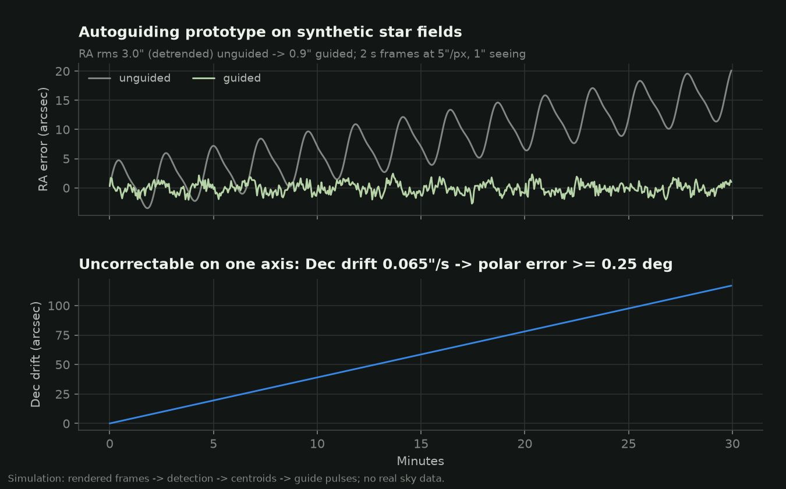

# Next step: autoguiding (the "vision" half)

The tracking-error model says the first thing limiting sub length at 200 mm is the lead screw's
periodic error (PE), predicted at about +-5 arcsec with a ~137 s period, not polar alignment.
Two vision-based answers follow, in order of effort:

1. **Measure PE once and correct it open-loop (PEC).** The firmware already supports a 64-entry
   correction table indexed by screw phase; the model predicts the 200 mm sharp-sub limit goes
   from ~21 s to ~77 s if 75 % of the screw PE is removed. Measurement can be done indoors with a
   laser dot on a wall and a webcam (build guide section 10), or on the sky with the guide camera
   below and guiding switched off.
2. **Close the loop (autoguiding).** A guide camera watches a star field and nudges the drive
   rate every few seconds, cancelling PE, rate error and slow flexure together.

## Design

```
 guide scope (~120 mm f/4 lens)        host: Raspberry Pi 4/5 or a laptop
 + IMX290/462 mono camera  --USB-->    capture 2 s frames
   (2.9 um -> ~5"/px)                  detect stars, centroid, match to reference
                                       error in RA/Dec (arcsec)
                                       controller (aggressiveness 0.7, hysteresis 0.1)
                                       HTTP  GET /api/cmd?c=guide%20<ms>%20<0.5|1.5>
                                                 |
                                       ESP32 tracker: MotionController::guide()
                                       re-anchors the tracking schedule at 0.5x or 1.5x
                                       sidereal for <ms>, then returns to 1x
```

Why these choices:

- **Camera.** An ESP32-CAM's OV2640 cannot do multi-second exposures with useful sensitivity;
  a small mono CMOS guide camera (IMX290/462, the class sold for planetary/guiding) or a
  Raspberry Pi HQ camera can. A 120 mm guide lens gives ~5"/px, and centroiding reaches ~0.1 px
  on decent stars, about 0.5", well inside the 3.8"/px of the main camera at 200 mm.
- **Interface.** The firmware's `guide <ms> <multiplier>` command already exists and is
  unit-tested (`test_motion.cpp: guide_pulse_shifts_by_expected_angle`): a pulse at 1.5x for
  2 s advances the board by exactly 15 arcsec, and the schedule stays position-based, so guide
  pulses never accumulate rounding error. PHD2 users could add an ST-4 input on two spare GPIOs
  later; HTTP keeps the first version wire-free.
- **One axis.** A barn door turns about one axis, so only RA can be corrected. The leftover
  declination drift is itself a measurement: its rate is the polar-alignment error (at least
  the component perpendicular to the target's hour circle). The prototype reports it, which
  turns the guider into a drift-alignment tool.

## Prototype (synthetic star fields)

`src/startracker/autoguide.py` implements the loop end to end on rendered frames: Gaussian
PSFs, sky background, shot and read noise; robust background + local-maximum detection;
centroiding; matching against the reference frame seeded with the previous shift; a PHD2-style
hysteresis controller; guide pulses applied to a simulated tracker carrying the same PE, rate
error and polar drift as the error model.



Result on 30 minutes of simulated frames (2 s exposures, 5"/px, 1" seeing jitter): RA error
3.0" RMS unguided (after removing the linear drift; 5.4" with it) -> **0.9" RMS guided**; the
measured declination drift, 0.065"/s, recovers the simulated 0.25 deg polar error. Tests in
`tests/test_autoguide_pec.py` pin these behaviours (sub-pixel centroids, shift recovery,
guided RMS < half the unguided RMS, drift recovery).

What this does **not** show: performance on real frames (hot pixels, clouds, satellites, dew,
star loss), real seeing statistics, or real mechanics (backlash on rate reductions, flexure).
Those need recorded frames from the actual guide camera; the code is structured so a frame
source can be swapped for the renderer.

## Plan

1. Build the tracker; run the laser-dot PE test; load PEC; confirm with star trails at 200 mm.
2. Record 30 min of guide-camera frames with guiding off (gives a real PE measurement too).
3. Run the detection/matching code on the recording; compare against the synthetic numbers.
4. Close the loop over HTTP; log RA residuals; tune aggressiveness and hysteresis.
5. Use the Dec-drift estimate to refine polar alignment.
