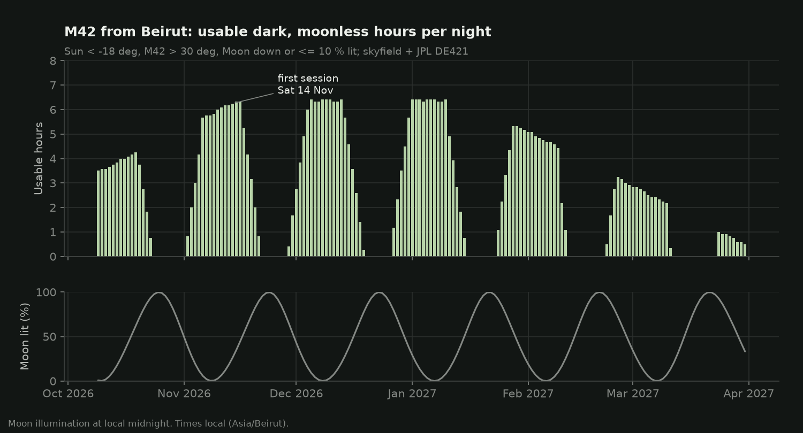
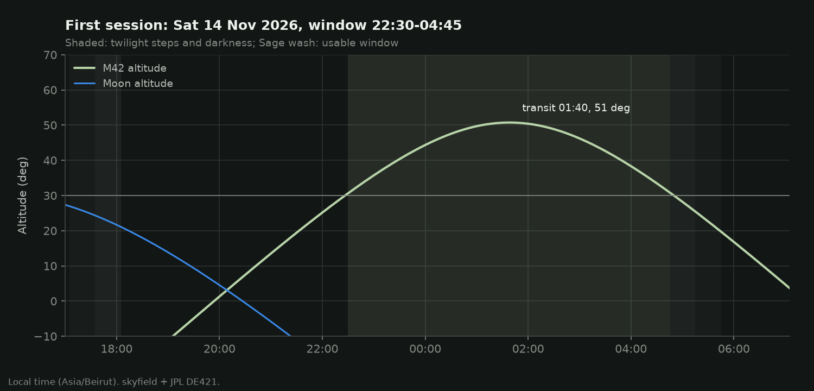

# First-session plan: M42 from Lebanon

_Generated by `startracker plan` on 2026-10-09. Ephemeris: skyfield + JPL DE421. Times are local (Asia/Beirut)._

> Every exposure length, blur and SNR figure here is a **prediction** from the models in
> `src/startracker/` (assumptions listed in README section 6). Nothing has been tested
> on the sky yet.

## Criteria

- Site: Beirut (33.8938 N, 35.5018 E). A darker site inland changes these times by only minutes.
- Astronomical darkness: Sun below -18 deg.
- M42 (Orion Nebula) at least 30 deg up (airmass <= 1.99).
- Moon below the horizon, or at most 10% illuminated.

## Season at a glance

| Month | Nights with >= 2 h | Usable hours | Best night | Best window |
|---|---|---|---|---|
| Oct 2026 | 13 | 52 | Mon 19 Oct | 01:10-05:25 |
| Nov 2026 | 18 | 94 | Sun 15 Nov | 22:25-04:45 |
| Dec 2026 | 21 | 110 | Sat 05 Dec | 21:05-03:30 |
| Jan 2027 | 20 | 110 | Fri 01 Jan | 19:20-01:45 |
| Feb 2027 | 15 | 63 | Mon 01 Feb | 18:35-23:40 |
| Mar 2027 | 10 | 32 | Mon 01 Mar | 19:00-21:50 |

## Recommended first session

**Saturday 14 November 2026**, night into Sunday (on or after 01 Nov 2026, leaving time to build and bench-test).

- Astronomical darkness 18:05-04:45; usable M42 window **22:30-04:45** (6h15).
- M42 transits at 01:40, reaching 51 deg in darkness. Moon at midnight: 27 % lit.
- Backups: Sun 15 Nov 22:25-04:45 (6h20); Mon 16 Nov 22:25-04:45 (6h20); Sat 05 Dec 21:05-03:30 (6h25); Fri 11 Dec 20:45-03:05 (6h20)

### Timeline

- **21:00** (T-90 min): Arrive, set up the tripod on firm ground, level it roughly, power on, connect to the StarTracker Wi-Fi (the page sends the phone's clock).
- **21:15** (T-75 min): Home the tracker. Polar-align with the sight tube: Polaris on the reticle ring at the clock position the web page shows. Lock the tripod head.
- **21:40** (T-50 min): Mount the camera. Manual mode, RAW, IS off, AF off, long-exposure noise reduction off, live view x10 on a bright star; focus with the Bahtinov mask.
- **22:00** (T-30 min): Frame M42 (below Orion's belt). Test frames: 5 s at ISO 1600 to frame, then one full-length sub - check stars at 100 %, histogram peak in the left third.
- **22:20** (T-10 min): Rewind to the start of travel so the first run gets the full ~2.3 h.
- **22:30** (T): Start tracking (sidereal) and the BULB sequence from the web page.
- **00:50** (T+140 min): Before end of travel (the page shows time left): stop, rewind (~40 s), re-frame, restart.
- **04:45**: window ends. Shoot calibration frames (below) before packing up.

### Exposure settings (predicted)

Camera: Canon APS-C 24 MP (assumed), 3.72 um pixels. Tracking limits are the longest sub whose predicted trail stays <= 1.5 px with 0.25 deg polar error (sight tube), lead-screw PE +-4 um (assumed) and no PEC. 'Expected' adds the independent errors in quadrature; 'worst' adds them linearly. Subs are capped at 120 s and the first night's integration at 60 min.

**Dark site** (assumed sky 20.5 mag/arcsec^2):

| Lens | Scale | Field | Sharp sub, expected / worst | ISO | Sub | Subs | Integration |
|---|---|---|---|---|---|---|---|
| Telephoto 200 mm f/5.6 | 3.8"/px | 6.4 x 4.3 deg | 21 s / 11 s | 1600 | 20 s (a) | 180 | 60 min |
| Telephoto 135 mm f/5.6 | 5.7"/px | 9.4 x 6.3 deg | 36 s / 20 s | 1600 | 35 s (a) | 102 | 60 min |
| Kit zoom 55 mm f/5.6 | 13.9"/px | 22.9 x 15.4 deg | 280 s / 120 s | 3200 | 120 s | 30 | 60 min |

(a) Read-noise limited: the sub is too short for this dark a sky to bury the read noise (sky noise < sqrt(5) x read noise). Fine for M42, which is bright; stack more subs.

**Beirut city** (assumed sky 18.0 mag/arcsec^2):

| Lens | Scale | Field | Sharp sub, expected / worst | ISO | Sub | Subs | Integration |
|---|---|---|---|---|---|---|---|
| Telephoto 200 mm f/5.6 | 3.8"/px | 6.4 x 4.3 deg | 21 s / 11 s | 800 | 20 s | 180 | 60 min |
| Telephoto 135 mm f/5.6 | 5.7"/px | 9.4 x 6.3 deg | 36 s / 20 s | 400 | 35 s | 102 | 60 min |
| Kit zoom 55 mm f/5.6 | 13.9"/px | 22.9 x 15.4 deg | 280 s / 120 s | 400 | 120 s | 30 | 60 min |

**Plan for the night:** Telephoto 200 mm f/5.6 (e.g. EF-S 55-250 at 200 mm, wide open), ISO 1600, **180 x 20 s** BULB subs, 3 s gap (about 60 min of integration). If the test frame shows trailing, drop to 135 mm or halve the sub length - many short subs stack fine on a target as bright as M42.

The Trapezium core saturates in long subs. Add **20 x 3 s** subs at the same ISO for an HDR blend of the core (optional for a first photograph).

Predicted per-pixel SNR of the stack (rough photometry, +-50 %): outer nebulosity (~21.5 mag/arcsec^2) 7 at the dark site vs 3 in Beirut; bright Huygens region (~18) 84 vs 63. The city sky still gives a clear M42; the dark site gives the outer wings.

### Calibration frames

- **Darks:** 20 x 20 s, same ISO, lens cap on, at the end of the session (same temperature).
- **Flats:** 30 at the same focus and aperture: white T-shirt over the lens, pointed at the dawn sky or a tablet showing white; Av mode.
- **Bias:** 50 at the fastest shutter speed, cap on, same ISO.

### Processing (free software)

Siril (Linux/Windows/macOS) or DeepSkyStacker (Windows): calibrate, register, stack with sigma clipping; reject frames with high FWHM/roundness. Then background extraction, colour calibration, a gentle stretch. Stars should be round at 100 % - the measurable test of this tracker.

## Why these numbers

Predicted trail budget for one 20 s sub at 200 mm (3.83"/px), worst point of the travel:

| Source | Trail (arcsec) | Pixels |
|---|---|---|
| polar alignment | 1.31 | 0.34 |
| drive rate | 0.18 | 0.05 |
| lead screw PE | 5.26 | 1.37 |
| stepper microstep | 1.03 | 0.27 |
| microstep quantisation | 0.64 | 0.17 |
| refraction | 0.21 | 0.06 |
| **sum (worst)** | **8.63** | **2.25** |
| **RSS (expected)** | **5.56** | **1.45** |

Untracked at the same focal length: 0.38 s for the same 1.5 px criterion (500 rule: 1.6 s; NPF: 1.5 s). Tracking buys a factor of ~54 in sub length.

